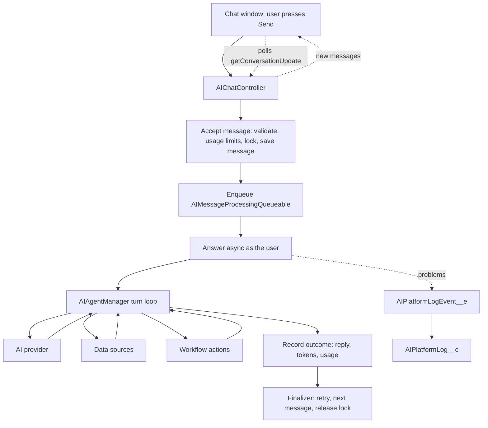

# Architecture

AI Assist is a Salesforce package that lets users chat with AI agents inside Salesforce. This page shows how the pieces fit together; the other pages in this section go deeper on one topic each.

## The layers

Each layer has one job and only calls the layers below it.

| Layer | One job | Main classes |
|---|---|---|
| Chat window | Show the conversation, send messages, poll for the reply | `aiAssistChat` (LWC), `AIChatController` |
| Accept a message | Check the request is allowed, apply limits, take the lock, save the message, enqueue | `AIMessageValidator`, `AIUsageLimitService`, `AIConversationLockService`, `AIConversationMessageService` |
| Answer asynchronously | Load everything the turn needs and run it as the user | `AIMessageProcessingQueueable`, `AIMessageProcessingFinalizer` |
| Turn loop | Talk to the provider, run the tools the model asks for, repeat until a final reply | `AIAgentManager` |
| Providers and tools | Shape requests per provider, run data sources and workflow actions | `AIProvider`, `AIDataSourceDispatcher`, `AIWorkflowActionDispatcher` |
| Outcome | Save the reply or the failure, tokens and evidence | `AIMessageOutcomeService`, `AIExecutionStepRecorder` |
| Logging | Record problems without ever causing one | `AIPlatformLogManager` and `AIPlatformLogEvent__e` |

## How a message flows

The chat window never waits on the provider. It saves the message, then polls until the reply is there. The full sequence is in [Message lifecycle](message-lifecycle.md).

## Design principles

- **Accepting is separate from answering.** The send call only validates and saves. The slow work happens in a queueable job, so the user's request never holds a callout open.
- **One message at a time per conversation.** A lock stored on the conversation keeps replies in order. See [Usage limits and throughput](usage-limits.md).
- **The job runs as the user.** Records are read in user mode where the user is expected to have access. Where the package must write system-managed fields, it does so through a small number of explicit system-mode classes. See [Security model](security-model.md).
- **The turn loop makes callouts only.** `AIAgentManager` never inserts, updates or publishes. The caller records the outcome after the last callout, which avoids "uncommitted work pending" errors.
- **A finalizer owns the end of every job.** Retries, handing the lock to the next message and releasing it all happen there, even if the job was killed by a governor limit.
- **Providers are plugged in, not branched on.** Each provider has a request builder and a response handler. See [Providers](providers.md).
- **Personal data is masked before it leaves Salesforce.** See [PII protection](pii-protection.md).
- **Logging must never fail the caller.** Errors become platform events and are saved later. See [Logging and jobs](logging-and-jobs.md).

## Where things live

| You want | Look in |
|---|---|
| Apex source | `force-app/main/default/classes` (each class starts with a header comment that lists its steps) |
| Objects, fields, triggers | `force-app/main/default/objects`, `triggers` |
| Chat window and admin tabs | `force-app/main/default/lwc` |
| Generated reference for each Apex area | [Apex reference](../reference/apex/index.md), for example [Messaging pipeline](../reference/apex/messaging-pipeline.md) |
| Objects and relationships | [Data model](../reference/data-model.md) |
| Permission sets | [Permission sets](../reference/permission-sets.md) |
| Open problems | [Known issues](../runbooks/known-issues.md) |
