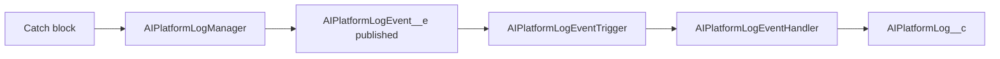

# Logging and scheduled jobs

AI Assist records problems without letting logging cause one, and runs daily housekeeping from a single scheduled job. Class summaries are in the [logging and jobs reference](../reference/apex/logging-and-jobs.md).

## Logging

`AIPlatformLogManager` publishes an `AIPlatformLogEvent__e` instead of inserting a record. The event is set to publish immediately, so the entry survives even if the calling transaction rolls back. It offers `logException`, a DML failure logger, `logCustomMessage` (severity Warning) and an audit entry (Info) for changes to a credential or to who may use one.

It is built never to throw:

1. It skips quietly when the publish allowance is used up (the audit entry is published anyway).
2. It cuts each text field to the event's field size, since an over-length value would fail the whole publish.
3. If the publish fails it writes a debug line with the class name only.

`AIPlatformLogEventTrigger` does nothing while the application is switched off. Otherwise `AIPlatformLogEventHandler` turns each event into an `AIPlatformLog__c` record, once per transaction. It swallows its own failures, because logging them would publish another event into the same trigger. Log fields include class, method, severity, exception type and message, stack trace, related record and user.

## Scheduled jobs

`AIMaintenanceScheduler` is the one scheduled job, named `AI Assist Maintenance` and set for 2am daily in the time zone of the user who schedules it. `scheduleDaily()` does nothing if a job of that name already exists.

Each run does the following, and a task that cannot start is logged so it does not stop the others:

| Step | Runs | What it does |
|---|---|---|
| Fail held messages | Always | Fails messages held at the cap on messages in flight for more than 5 minutes |
| `AIConversationRetentionBatch` | Always, so switching AI Assist off never stops data expiring | Deletes conversations past `RetentionExpiryDate__c` unless `IsOnLegalHold__c`, feedback first |
| `AIConversationIdleBatch` | Only while the application is on | Closes active conversations idle longer than the agent's `IdleTimeoutMinutes__c`, unless a reply is still being produced |
| `AIPiiRegistrySyncDispatcher` | Only while the application is on | Finds PII registries never synced, failed last time or past their cache reset date, marks them `Queued`, and enqueues one `AIPiiRegistrySyncWorker` |

The dispatcher takes no more registries than `MaxPIIRegistryObjects__c` allows.

## Retention recalculation

`AIConversationRetentionRecalcBatch` is not scheduled. `AIAgentTriggerHandler` starts it when an agent's `ConversationRetentionDays__c` or `RetentionTrigger__c` changes. It recomputes `RetentionExpiryDate__c` on that agent's conversations from the date the trigger counts from, adds the retention days, and writes only the conversations whose date changed. Blank or under 1 day means no expiry date.

## Related

- [Maintenance job runbook](../runbooks/maintenance-job.md)
- [PII sync failed runbook](../runbooks/pii-sync-failed.md)
