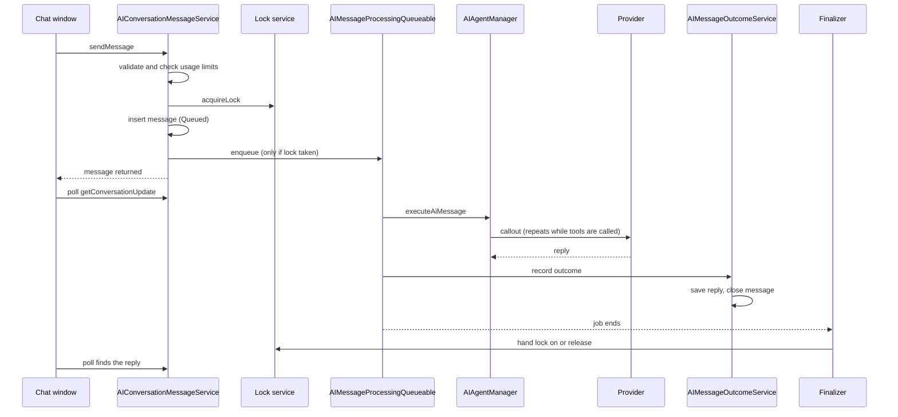
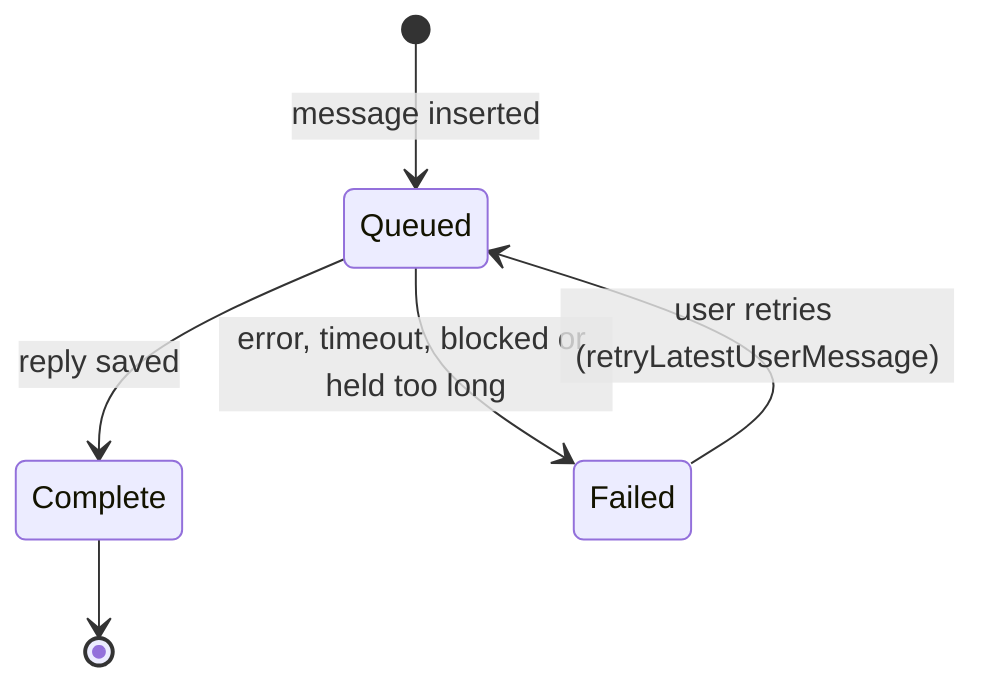
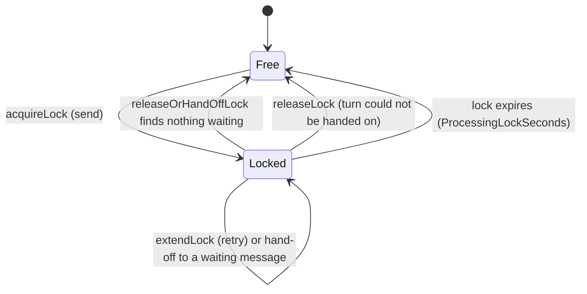

# Message lifecycle

This page follows one message from the moment the user presses Send to the moment the reply is on screen. The code for steps 1 to 4 is described in the [messaging pipeline reference](../reference/apex/messaging-pipeline.md).

## 1. Accepting the message

`AIConversationMessageService.sendMessage` runs in the user's own request. It never calls the provider.

1. `AIMessageValidator` refuses the request if the application is off or in maintenance, the user has no active usage policy, the text is empty or too long, the agent is inactive or not open to the user, the terms are not accepted, the channel is not allowed, or the user cannot read the record the chat is about.
2. It finds the open conversation to continue, or starts a new one. A conversation that has reached the agent's message or token cap is closed first, so the user gets a fresh one.
3. `AIUsageLimitService` checks the rate, daily and concurrency limits. See [Usage limits](usage-limits.md).
4. `AIConversationLockService.acquireLock` takes the conversation lock if it is free.
5. The user's message is inserted with `ProcessingStatus__c` of `Queued`.
6. If this message took the lock, `AIMessageProcessingQueueable` is enqueued. If the org is at the cap on messages in flight, the message stays `Queued` and is marked `IsAwaitingCapacity__c`. If the conversation was already locked, the message simply waits for the running job's finalizer to pick it up.

## 2. Answering it

`AIMessageProcessingQueueable` runs asynchronously as the user who sent the message.

1. It attaches the finalizer first, so the end of the job is always handled.
2. It reloads the message, and stands down if the conversation's lock has expired (another message has taken over).
3. It loads the conversation, agent, model configuration, prompt template, a bounded message history, and the agent's data sources and workflow actions.
4. It calls `AIAgentManager.executeAiMessage`, which loops: send the request, run any tools the model asks for, send the results back, until the model gives a final reply or a limit is hit. See [Providers](providers.md).
5. It saves any PII mappings created during the turn, and the provider's session reference when the provider keeps one (Anthropic Agent).

## 3. Recording the outcome

`AIMessageOutcomeService.recordAiResponseOutcome` runs after the last callout and never throws.

- **Success:** saves the AI reply with tokens, latency, model and prompt template, supersedes any earlier reply to the same question, and marks the user's message `Complete`.
- **Failure:** records the tokens spent, marks the message `Failed` with a `FailureReason__c`, and logs the real error. The user only sees a Custom Label chosen from the reason.
- The execution trace and masking records are saved as evidence by `AIExecutionStepRecorder`.
- Tokens and conversation counts are added to the user's daily `AIUsage__c` row by `AIConversationMessageTriggerHandler`, when the reply is inserted.

## 4. After the job: the finalizer

`AIMessageProcessingFinalizer` runs however the job ended.

| Situation | What it does |
|---|---|
| Lock had expired before the job started | Fails the stale turn as a timeout and leaves the lock alone |
| Job was killed (for example by a governor limit) | Logs it, records tokens, fails the message |
| Turn asked for a retry | Enqueues a new job (immediately the first time, then delayed) and keeps the lock |
| Turn finished | Hands the lock to the user's newest waiting message, or releases it |
| Nothing to hand on | Starts a message held at the cap on messages in flight |
| Next job cannot be enqueued | Fails the turn and frees the lock |

## 5. Showing the reply

The chat window calls `AIChatController.getConversationUpdate` on a timer. Polling starts after 2 seconds and backs off to at most 8 seconds while a reply is on its way, or 60 seconds while a message is held waiting for capacity. Each update returns the conversation status, whether a reply is still being produced (the lock is in the future, or the message is held) and any messages newer than the last one the window has.

There is no push of the reply. The cost of this is covered in [Usage limits and throughput](usage-limits.md).

## Message states

`AIConversationMessage__c.ProcessingStatus__c` has four values: `Queued`, `Processing`, `Complete`, `Failed`.

!!! warning "To confirm"
    `Processing` is a picklist value and has a constant (`PROCESSING_STATUS_PROCESSING`), but no non-test class sets it. In practice a message goes straight from `Queued` to `Complete` or `Failed`. Is `Processing` meant to be set when the job starts?

The conversation lock is a time, not a flag: `AIConversation__c.ProcessingLockedUntil__c`. Locked means the time is in the future.

