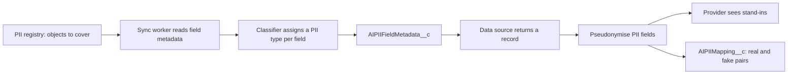

# PII protection

AI Assist replaces personal data with stand-in values before data leaves Salesforce for the provider. This page covers how fields are classified, how masking works and what is stored. Class summaries are in the [PII reference](../reference/apex/pii-protection.md); to set it up, see the [PII registry admin guide](../admin-guide/pii-registry.md).

## The flow

## 1. Registry and classification

An `AIPIIRegistry__c` row names one object to protect. `AIPiiRegistrySyncWorker` reads that object's fields and their Data Classification Compliance Group, then `AIPiiFieldTypeClassifier` gives each field a PII type (Name, Email, National Insurance Number and so on). The result is one `AIPIIFieldMetadata__c` row per field, keyed on `FieldKey__c`.

The classifier works from custom metadata:

- `AIPiiFieldType__mdt`: keyword rules matched against the field's API name or label, in `DisplayOrder__c`. The first match wins.
- `AIPiiComplianceGroup__mdt`: a compliance group (for example a regulation) with a fallback type for fields in that group. With no match the type is `Other`.

An administrator can override a field's PII choice. `IsOverridden__c` stops later syncs overwriting it. The sync runs from the daily job for registries that are due; see [Logging and jobs](logging-and-jobs.md).

## 2. Pseudonymisation before sending

When a data source result is built, `AIDataSourceResultProcessor` passes each field value to `AIPiiPseudonymizationService.pseudonymize`. A field that is not PII passes through unchanged. For a PII field:

1. If the real value already has a stand-in in this conversation, reuse it, so the model sees consistent values.
2. Otherwise find the masking rule for the field's type (`AIPiiDataMaskingRule__mdt`) and pick an unused substitute.
3. If there is no usable rule, or every substitute is used, use a generic `REDACTED` value with a random suffix so different real values never share one fake value. This is logged.
4. Remember the pair and count what was masked, by object and field.

Masking rules have a `Strategy__c`: `SubstituteFromList` (pick from `SubstituteValues__c`), `RandomizeByPattern` or `PatternReplace`. From the code, only `SubstituteFromList` is applied; other strategies fall back to redaction.

!!! warning "To confirm"
    `AIPiiPseudonymizationService` only applies `SubstituteFromList` and treats the other two strategies as "not applied". Is that intended for now?

If masking fails, the turn fails with the reason `PII Masking Failed` rather than sending unmasked data.

## 3. Restoring values

`AIPiiPseudonymizationService.restore` turns a stand-in back into the real value, using the conversation's mapping.

!!! warning "To confirm"
    `restore` exists and is tested, but no non-test class calls it. I could not find where a reply is restored before the user sees it. Is restoration done elsewhere, or not yet wired in? Also, only data source results are masked in code I found; text the user types is sent as typed.

## What is stored

| Object | Contents |
|---|---|
| `AIPIIRegistry__c` | One object covered, sync status and cache reset date |
| `AIPIIFieldMetadata__c` | Each field's type, compliance group and whether it is PII |
| `AIPIIMapping__c` | One per conversation: `MappingJson__c` with the real and fake pairs |
| `AIPIIMaskingRecord__c` | Audit evidence per masked field: object, field, type, strategy, outcome, values masked, linked to the message |

Mappings are held in memory during the turn and saved once after the last callout, because unsaved changes would block the next callout. Mappings and masking records are deleted with their conversation by the retention batch.
