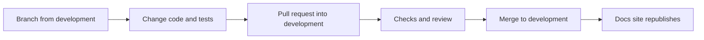

# Developer Guide

How the AI Assist repository is laid out, how a change gets from your machine into `development`, and where to read next.

## Repository layout

| Path | What is in it |
|---|---|
| `force-app/main/default/` | All the package metadata: `classes`, `triggers`, `lwc`, `objects`, `labels`, `permissionsets`, `flexipages`, `flows`, `tabs`, `applications`, `customPermissions`, `globalValueSets`, `layouts`, `contentassets`. |
| `config/project-scratch-def.json` | The scratch org definition. |
| `docs/` | Plain-text working notes: the object model and Apex review checklists, the three code pattern files, `known-issues.txt`. The code patterns are summarised on [Code patterns](code-patterns.md) and [Testing](testing.md). |
| `documentation/` | The markdown behind this site. `reference/`, `changelog.md`, `codebase-health.md` and `_stats.md` are generated. Do not edit them by hand. |
| `scripts/apex/` | Anonymous Apex for demos and sample data (`scripts/apex/sample-data`). |
| `scripts/ci/` | Node scripts the workflows call: `check-naming.js`, `check-coverage.js`, `assign-permsets.js`, `pr-comment.js`. |
| `scripts/docs/` | `generate.py` and its requirements, which build the generated pages. |
| `scripts/load-sample-data.sh` | Loads sample data into a sandbox or scratch org. |
| `.github/` | Workflows, the PR labeller, naming exceptions, Dependabot. See [CI and releases](ci.md). |
| `mkdocs.yml` | The site configuration and navigation. |

Apex classes are named by area, so related files sort together: `AIChat*` (the chat window), `AIConversation*`, `AIMessage*` (the processing pipeline), `AIPii*`, `AIUsage*`, `AIPolicies*`, and a `Controller`, `EditorService` and `DataStructure` trio for each admin tab (for example `AIModelsController`, `AIModelsEditorService`, `AIModelsDataStructure`). Interfaces start with `IAI`. The Apex reference is in [Reference](../reference/apex/index.md).

## How a change flows

1. Create a `feature/<name>` branch from `development`. Keep it current with `git merge development`.
2. Change the metadata. Follow [Code patterns](code-patterns.md), and add or update the matching test class ([Testing](testing.md)).
3. If you add an object or field, add it to the `AIAssistSuperUser` permission set, and to the other sets that need it.
4. Open a pull request into `development` with a title like `feat: add agent wizard` (see [CI and releases](ci.md)).
5. After the merge, the documentation site rebuilds from `development`.

!!! note "Branches"
    `development` is the working branch: features merge here and the docs site is published from it. `master` is only the GitHub default branch.

## Where to start

- To understand what the product does, read the [Architecture](../architecture/index.md) pages, starting with the message lifecycle.
- To change a class, find it in the [Apex reference](../reference/apex/index.md), then read its header comment: it lists the steps the class performs.
- To add a provider, a data source or a workflow action, read [Extending AI Assist](extending.md).
- To see what is known to be wrong, read [Known issues](../runbooks/known-issues.md) and [Codebase health](../codebase-health.md).

## In this guide

| Page | Read it when |
|---|---|
| [Code patterns](code-patterns.md) | You are writing or reformatting an Apex class or a Lightning web component. |
| [Testing](testing.md) | You are writing an Apex test, or a test is failing in a way you do not understand. |
| [Extending AI Assist](extending.md) | You are adding a provider, a data source or a workflow action. |
| [CI and releases](ci.md) | You are opening a pull request, or changing a workflow or this site. |
